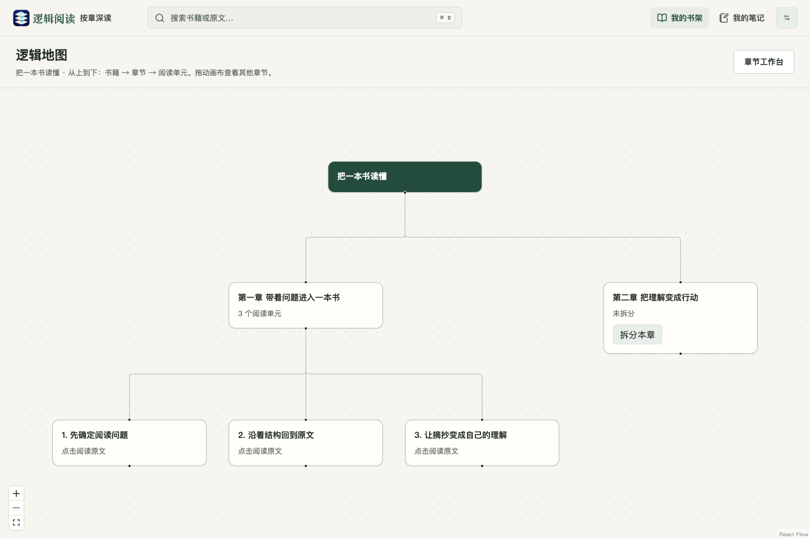

<p align="center">
  
</p>

<h1 align="center">逻辑阅读 · DuoBook</h1>

<p align="center"><strong>先看结构，再读原文。按章拆解，一层层读懂一本书。</strong></p>

<p align="center">
  
  <a href="LICENSE"></a>
  
  
</p>

<p align="center">
  <a href="#功能亮点">功能亮点</a> ·
  <a href="#截图导览">截图导览</a> ·
  <a href="#使用场景">使用场景</a> ·
  <a href="#快速开始">快速开始</a> ·
  <a href="#常见问题">常见问题</a> ·
  <a href="docs/技术方案v2-按章深读工作台.md">技术文档</a>
</p>


## 项目介绍

**逻辑阅读是一个以原文为中心的按章深读工作台，支持网页版和 macOS 桌面版。**

阅读顺序由你掌握：先从全书目录了解结构，选一章直接阅读；需要深入时，手动把本章拆成带标题的阅读单元，再从地图逐层进入原文。把摘抄、疑问和理解留在对应位置，下次打开继续读。

从导入到复盘，主要流程是：

```text
导入电子书 → 确认章节目录 → 选择一章，直接阅读原文
                               ↓ 手动点击“拆分本章”
                        阅读单元标题 + 九段阅读骨架
                               ↓
               逻辑地图定位 → 原文深读 → 划线 / 摘抄 / 笔记
                               ↓
                    笔记汇总与导出，下次从原位置继续
```

当前版本 **1.2.8**。导入时不自动解析整本书；每次拆分只处理你选中的一章。

## 功能亮点

| 能力 | 可以做什么 | 对阅读有什么帮助 |
| --- | --- | --- |
| **导入与书架** | 导入 EPUB、文字型 PDF、TXT，确认章节顺序和标题；优先提取原版封面，缺失时使用图形封面 | 先把书整理好，再决定从哪里开始 |
| **按章语义拆分** | 接入模型后，把选中的章节拆成可独立进入的阅读单元；支持重新拆分与历史版本 | 长章可以分次读，已有版本和笔记保留 |
| **自上而下的逻辑地图** | 展示“书籍 → 章节 → 阅读单元”，点击标题进入原文；未拆分章节可从地图发起拆分 | 先看全貌，再逐层深入；触摸板双指移动画布 |
| **九段深读骨架** | 为每个单元准备原文、字词注、白话直译、注家对照、前后连接、问题、生活关联、理解 / 疑问、回看批注 | 给思考一个位置，便于补充和复盘 |
| **划线、摘抄与笔记** | 鼠标选择原文，可只摘抄或写笔记；未拆分章节也能使用 | 在读到的地方记下想法，保留准确来源 |
| **笔记汇总与导出** | 按类型查看阅读记录，回到原文；导出 Markdown 或 JSON | 方便复习、写作和继续整理资料 |
| **语音阅读** | 本地系统语音 / 小米 MiMo，支持音色、声调和 0.5–2 倍语速 | 阅读与听读可以配合，解析和语音配置独立 |
| **单行悬浮阅读** | 单行显示原文，支持拖动、前后翻行、语音自动翻行、两位小数进度、透明度和置顶 | 在电脑多任务场景下，用较小的窗口继续阅读 |
| **阅读位置记忆** | 保存章节、单元、段落和单行字符偏移；从书架打开自动恢复 | 读到哪里，下次就从哪里继续；恢复时保持静音 |
| **模型与外观设置** | OpenAI 兼容 / Anthropic 协议、连接测试、独立 MiMo 配置，以及四款应用图标 | 复用自己的服务，按个人偏好设置应用 |

九段骨架中，**原文自动就位且不可编辑，其余区域供读者按需补充**。拆分结果用于组织原文，笔记承载自己的理解。

## 截图导览

以下为 **1.2.8 实际界面**。书稿、阅读单元和笔记使用人工准备的演示数据，不涉及私人书籍或 API Key；语义拆分效果取决于你配置的模型。[截图来源说明](docs/screenshots/README.md)

### 1. 章节工作台：选一章，再决定是否拆分

左侧是章节目录，右侧展示本章原文和已发布的阅读单元。点击单元卡片进入深读；“重新拆分本章”生成新版本，历史版本及其笔记保留。

适合先读原文、遇到长章后再逐步拆解的阅读习惯。


### 2. 逻辑地图：从全书结构走到一段原文

地图从上到下排列书籍、章节和单元。图中第一章已有三个单元，第二章仍显示“未拆分”，可以直接点击“拆分本章”。已发布的单元标题可以打开对应原文。

适合先了解章节结构、带着问题查读，或复习时快速定位。



### 3. 原文深读：划线、思考和语音放在一起

阅读单元保留连续原文及其来源。选中一句话，可以直接摘抄或写下笔记；上方可选择本地 / MiMo 语音、音色、声调和语速，也可进入单行阅读。

适合逐段理解概念、核对上下文，或边听边读。


<details>
<summary><strong>展开查看：九段骨架如何记录自己的理解与疑问</strong></summary>

每个单元都有独立的九段骨架。可以先读原文，再按需要补充字词、关联和问题；“你的理解 / 疑问”与“回看批注”留给自己填写。图中展示了人工填写的理解、疑问和回看提醒。


</details>

### 4. 阅读笔记：把读过的内容变成可复用的积累

九段笔记、摘抄与划线笔记集中展示，并保留书名、章节、单元和原文入口。可以按类型筛选，导出 Markdown 用于整理，或导出 JSON 用于后续处理。

适合复习、准备读书分享，以及写文章时回查引用。


### 5. 单行小窗：用一行保留阅读节奏

桌面版默认约 **600 × 36 像素**，左侧把手可拖动。右侧显示当前章 / 单元进度，如 `35.56%`，支持翻行、播放、置顶和更多设置。宽度、字号及背景透明度均可调整。

<p align="center">
  
</p>

- `←` / `Page Up` 上一行，`→` / `Page Down` 下一行，空格播放 / 暂停。
- 语音读完当前行后自动翻行，可开启连续朗读下一章 / 单元。
- 桌面默认 `⌘ + Shift + H` 全局隐藏 / 显示小窗，其他应用聚焦时也可使用；可在设置中改键或关闭。
- 隐藏会停止朗读；再次显示保留位置，保持静音且不抢焦点。
- `Esc` 在阅读窗口聚焦时收起正文，点击“资料 · 点击恢复”手动恢复。

适合在电脑上查资料、整理工作内容时穿插短时阅读。更多操作见 [单行阅读使用说明](docs/单行阅读使用说明.md)。

## 使用场景

| 场景 | 建议使用流程 | 留下什么 |
| --- | --- | --- |
| **读一本理论或非虚构书** | 先看章节地图 → 选择相关章节 → 拆分一个长章 → 逐单元回到原文 | 书籍结构与每个单元的理解记录 |
| **用短时间读长篇内容** | 打开上次位置 → 读一个单元 → 记下未解决的问题 → 下次继续 | 连续的阅读位置和明确的下一步 |
| **课程学习或考试复习** | 阅读概念 → 标记原文 → 在九段骨架中复述、提问 → 汇总笔记回看 | 概念解释、疑问和复习线索 |
| **准备读书分享或写文章** | 划线摘抄 → 写下观点 → 回到原文核对 → 导出 Markdown | 带有来源上下文的素材 |
| **做家务或整理资料时听读** | 选择本地 / MiMo 语音 → 调整语速和音色 → 连续听读 | 当前阅读位置，方便切回原文 |
| **电脑多任务下轻量阅读** | 打开单行小窗 → 调整位置 / 透明度 → 翻行或听读 → 需要时隐藏 | 不依赖完整阅读页的短时阅读入口 |
| **隔几天接着读** | 从书架“继续阅读”打开 → 自动回到章节 / 单元与原文位置 | 同一本书持续积累的笔记和进度 |

## 网页版与桌面版

| 功能 | 网页版 | macOS 桌面版 |
| --- | --- | --- |
| 导入、章节工作台、逻辑地图、划线笔记 | 支持 | 支持 |
| 模型解析、本地 / MiMo 语音 | 支持；本地语音取决于浏览器和系统声音 | 支持；本地语音使用系统声音 |
| 阅读位置保存 | 当前服务实例的 SQLite | 桌面本机 SQLite |
| 单行阅读 | 页面内拖动阅读条 | 独立原生悬浮小窗 |
| 置顶 | 当前页面内置顶 | 系统窗口置顶 |
| 背景透明度 | 透出当前页面背景 | 可透出下方桌面或窗口 |
| 系统全局隐藏 / 显示 | 不支持 | 支持，默认 `⌘⇧H` |
| 模型设置持久化 | 解析配置在当前服务进程中；语音连接保存于本机配置文件 | 通过系统安全存储加密保存 |

桌面分发目前为 **macOS ARM64**。macOS 13 真机兼容性仍待验证，具体验证范围见 [修复记录](docs/修复记录.md)。

## 快速开始

### 1. 获取源码与依赖

需要 **Node.js 22+、Python 3.12+**。

```bash
git clone https://github.com/AmpereL/DuoBook.git
cd DuoBook

python3 -m venv .venv
.venv/bin/python -m pip install -r services/api/requirements.txt
npm ci
```

以下命令适用于 macOS / Linux；Windows 请使用虚拟环境内的 `Scripts\python.exe` 等对应路径。Windows 网页运行未做完整验收。

### 2. 启动后端与前端

在第一个终端运行：

```bash
.venv/bin/uvicorn app.main:app --app-dir services/api --host 127.0.0.1 --port 8000
```

在第二个终端运行：

```bash
npm run dev:web
```

打开 [网页版](http://127.0.0.1:5173)。后端 API 文档：<http://127.0.0.1:8000/docs>。

### 3. 导入并开始阅读

1. 点击“导入书籍”，选择 EPUB、文字型 PDF 或 TXT。
2. 确认书名、章节标题与顺序，完成导入。
3. 选择一章直接阅读；选中文字即可摘抄或写笔记。
4. 需要语义拆分时，先在“模型设置”配置连接，再点击“拆分本章”。
5. 从地图或单元卡片进入深读；从“阅读笔记”回看或导出。

无远程模型时，可以使用本地模式体验阅读流程：**本地模式将整章保留为一个单元；语义拆分需要接入模型。**

## 模型与语音配置

### 解析模型

在应用右上角打开“模型设置”，选择协议并填写 API 地址、模型名称和自己的 Key，先点击“测试连接”，再保存。

| 协议 | 对应接口 |
| --- | --- |
| OpenAI 兼容 | Chat Completions 格式 |
| Anthropic | Messages 格式 |

也可以在启动后端前配置环境变量，以下仅为占位示例：

```bash
export DUOBOOK_LLM_PROVIDER="openai" # 或 anthropic
export DUOBOOK_LLM_BASE_URL="https://your-provider.example/v1"
export DUOBOOK_LLM_API_KEY="your-api-key"
export DUOBOOK_LLM_MODEL="your-model"
export DUOBOOK_LLM_TIMEOUT_SECONDS="60"
```

### 语音模型

- **本地系统语音**：无需远程 Key，使用当前系统 / 浏览器可用的声音。
- **小米 MiMo**：在独立的语音连接设置中填写 API 地址和自己的 Key；支持地址 `https://api.xiaomimimo.com/v1`。
- 语音连接也可通过 `DUOBOOK_TTS_BASE_URL`、`DUOBOOK_TTS_API_KEY` 配置。
- 音色、声调和语速在阅读页或单行设置中调整，实际能力由所选引擎支持。

解析与语音配置独立，完整说明见 [语音阅读使用说明](docs/语音阅读使用说明.md)。

## 数据与隐私

书籍、原文、笔记和阅读位置保存在运行实例的本地 SQLite。导入和原文阅读可以在本地完成；手动使用远程模型拆分时，当前章内容会发送到你配置的服务，使用 MiMo 听读时会发送待合成的原文片段。

| 数据 | 默认位置 |
| --- | --- |
| 网页数据库 | `services/api/data/duobook.db` |
| 网页导入文件 | `services/api/data/uploads/` |
| 桌面书籍、笔记与设置 | `~/Library/Application Support/DuoBook/` |

网页数据库和文件目录可通过 `DUOBOOK_DB`、`DUOBOOK_UPLOAD_DIR` 覆盖。桌面 App ID 固定为 `com.duobook.reader`，升级沿用原数据目录。

仓库不包含私人 API Key、私人模型配置、书籍数据库或个人分发包。当前产品面向个人本机使用，默认监听 `127.0.0.1`；跨设备同步和多用户登录尚未提供。

## 开发与打包

### 技术栈

| 层级 | 实现 |
| --- | --- |
| 前端 | React 19、TypeScript、Vite、React Query、React Flow |
| 后端 | Python、FastAPI、SQLite |
| 桌面 | Electron + PyInstaller 打包的本地 Python 服务 |

### 构建与验证

```bash
npm run build:web
.venv/bin/python -m pytest services/api/tests -q
npm run test:e2e
node --test desktop/compact-shortcut.test.cjs
```

浏览器测试默认使用本机 Google Chrome；8000 / 5173 已被开发服务占用时，可换端口运行隔离回归：

```bash
DUOBOOK_E2E_API_PORT=8011 DUOBOOK_E2E_WEB_PORT=5181 npm run test:e2e
```

桌面启动与回归脚本位于 `desktop/*-smoke.cjs` 及 `desktop/smoke.cjs`，需要本机桌面包和图形会话。1.2.8 已记录的验证包括后端 50 项、全量浏览器 36 项，以及桌面单行、位置、语音和快捷键回归；详见 [修复记录](docs/修复记录.md)。

### macOS 私人分发包

```bash
npm run package:mac
```

当前脚本面向本机私人分发，需先准备 `.venv-macos13`、PyInstaller、Pillow 和本机模型配置 `services/api/data/model-defaults.json`；语音配置文件为 `speech-defaults.json`。脚本生成 ARM64 App、DMG 和 ZIP，版本取根目录 `package.json`。

个人包可能包含本机授权配置，请自行保管。当前 GitHub 仓库提供源码，个人 DMG / ZIP 未上传到 Releases。

## 常见问题

<details>
<summary><strong>导入后会立即调用模型解析整本书吗？</strong></summary>

不会。先导入并确认目录，然后选择某一章；点击“拆分本章”才会处理该章。未拆分时仍可直接阅读、划线和记笔记。

</details>

<details>
<summary><strong>逻辑地图展示哪些关系？</strong></summary>

展示书籍、章节和阅读单元的层级归属。已拆分章展开单元标题，点击进入原文；尚未拆分的章显示状态和拆分按钮。画布支持拖动、缩放，触摸板双指平移。

</details>

<details>
<summary><strong>重新拆分会影响已有笔记吗？</strong></summary>

重新拆分生成新版本。旧单元及其九段笔记保留在历史版本中，可从章节工作台打开；划线通过原文段落锚点关联。历史笔记不会自动迁移为新单元的九段内容。

</details>

<details>
<summary><strong>单行模式里的百分比是全书进度吗？</strong></summary>

表示当前章节 / 阅读单元的原文位置，以当前行末累计 Unicode 字符数计算，保留两位小数，末行显示 `100.00%`。它不表示音频的逐字播放时间。改变宽度或字号后，行末改变可能让百分比略有变化。

</details>

<details>
<summary><strong>支持扫描版 PDF、跨段划线或跨设备同步吗？</strong></summary>

目前支持文字型 PDF，尚不提供扫描件 OCR；划线以同一自然段的选区为范围，跨段内容需分别保存；阅读位置保存在本机实例，暂无跨设备同步。

</details>

## 文档与反馈

| 文档 | 内容 |
| --- | --- |
| [技术方案 v2](docs/技术方案v2-按章深读工作台.md) | 当前实现、数据模型、接口与边界 |
| [单行阅读使用说明](docs/单行阅读使用说明.md) | 小窗、快捷键、置顶、透明度与语音 |
| [阅读位置记忆](docs/阅读位置记忆使用说明.md) | 保存、恢复与限制 |
| [语音阅读使用说明](docs/语音阅读使用说明.md) | MiMo / 本地声音与配置 |
| [版本记录](docs/版本记录.md) | 版本功能摘要 |
| [修复记录](docs/修复记录.md) | 问题、根因、改动与实际验证范围 |

欢迎通过 [Issues](https://github.com/AmpereL/DuoBook/issues) 反馈问题或提出建议。报告问题时请附版本号、网页 / 桌面环境和复现步骤，并隐藏 Key 等私人信息。

## 许可证与致谢

本项目采用 [MIT License](LICENSE)。README 的栏目组织参考 [MinerU](https://github.com/opendatalab/MinerU)，截图与功能说明来自逻辑阅读当前实现。
